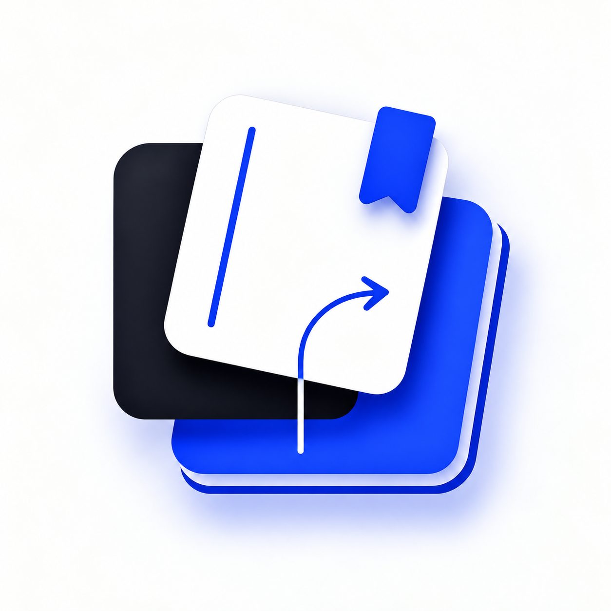

<p align="center">
  
</p>

<h1 align="center">Dictova</h1>

<p align="center">
  把 MDict 词典带进 macOS 原生“词典”App。
</p>

<p align="center">
  
  
  
</p>

Dictova 是一款原生 SwiftUI macOS 工具，可以把 `.mdx`、多卷 `.mdd` 和配套 `.css` 转换为 Apple“词典”App 可识别的 `.dictionary` 包，并一键导入到用户词典目录。

整个转换过程在本机完成。Dictova 不上传词典内容，也不会修改原始文件。

## 功能

- 一次选择主 `.mdx`、多个 `.mdd/.1.mdd/.2.mdd` 和 `.css`
- 支持直接拖入完整词典文件夹
- 保留图片、字体、音频和原始 CSS
- 清理 JavaScript、事件属性与不安全资源路径
- 自动修复常见的非标准 HTML/XML 属性
- 一键导入 `~/Library/Dictionaries`
- 转换完成后直接打开 Finder 或系统“词典”App
- 环境检查、日志复制、转换取消和自动导入
- 同时支持 Apple Silicon 与 Intel Mac

## 使用方法

1. 从 GitHub Releases 下载最新的 `Dictova.dmg`。
2. 打开 DMG，将 Dictova 拖入“应用程序”。
3. 选择词典文件夹，或者一次选择一个 MDX 及其 MDD、CSS 文件。
4. 确认词典名称和输出位置，然后点击“开始转换”。
5. 转换完成后点击“导入词典”。
6. 如果新词典没有立即出现，请打开系统“词典”App，在“设置”中启用它。

快捷键：

- `⌘O`：选择词典文件
- `⌘↩`：开始转换

## 构建

要求：macOS 13 或更高版本，以及 Xcode Command Line Tools 或 Xcode。

```bash
git clone https://github.com/chesliecheung/Dictova.git
cd Dictova
chmod +x build-app.sh
./build-app.sh
```

生成的应用位于 `dist/Dictova.app`。

首次转换时，Dictova 会在 `~/Library/Application Support/Dictova` 创建隔离的 Python 环境，并下载 `mdict-utils`、`lxml` 和 Apple Dictionary Development Kit 的公开镜像。Apple Silicon Mac 需要 Rosetta 2，因为 Apple 最后发布的 DDK 编译程序是 Intel 版本。

## 支持范围

适合：

- 未加密的 MDX/MDD 词典
- 静态 HTML 词条
- 图片、字体、音频和 CSS 资源

已知限制：

- 加密或需要注册码的词典暂不支持
- 依赖 JavaScript 的交互和发音按钮无法原样运行
- 个别严重损坏的词条会降级为纯文本，避免整本词典转换失败

## 隐私

Dictova 不收集遥测数据，不连接分析服务，也不会上传词典内容。更多信息见 [PRIVACY.md](PRIVACY.md)。

## 版权说明

本仓库不包含任何第三方词典数据。词典文件及其内容可能受版权保护，请仅转换和使用你有权处理的内容。

## 第三方组件

- [`mdict-utils`](https://github.com/liuyug/mdict-utils)（MIT）用于读取 MDX/MDD
- [`lxml`](https://lxml.de/)（BSD-3-Clause）用于规范化词条 HTML/XML
- Apple Dictionary Development Kit 由 Apple 发布，首次使用时按需下载，不包含在本仓库中

## 更新记录

参见 [CHANGELOG.md](CHANGELOG.md)。

## 许可证

Dictova 源代码采用 [MIT License](LICENSE) 发布。
